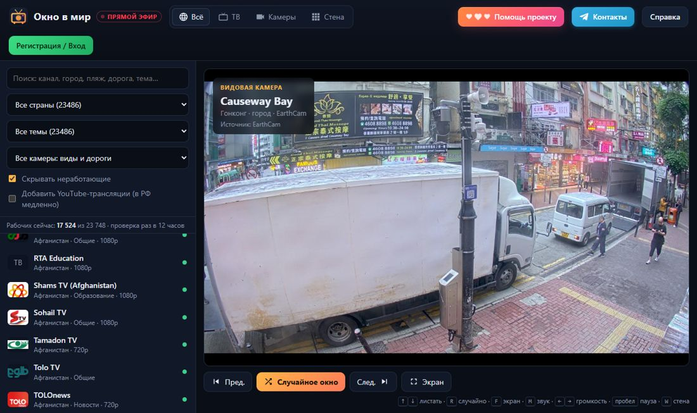
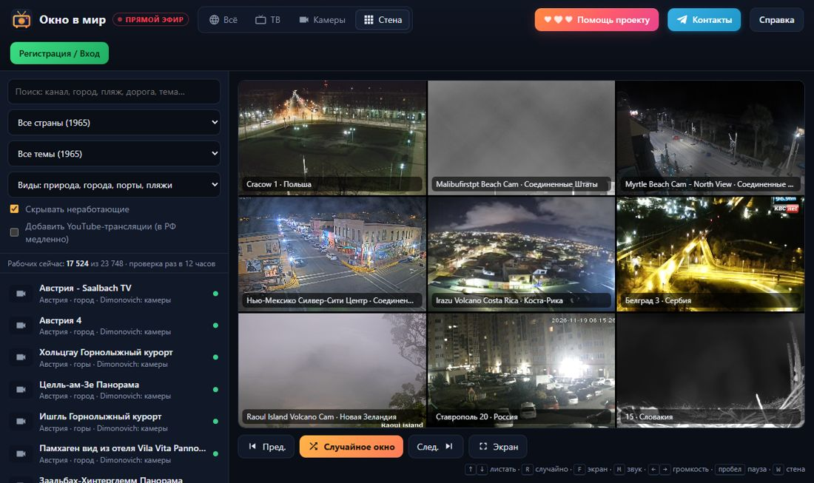
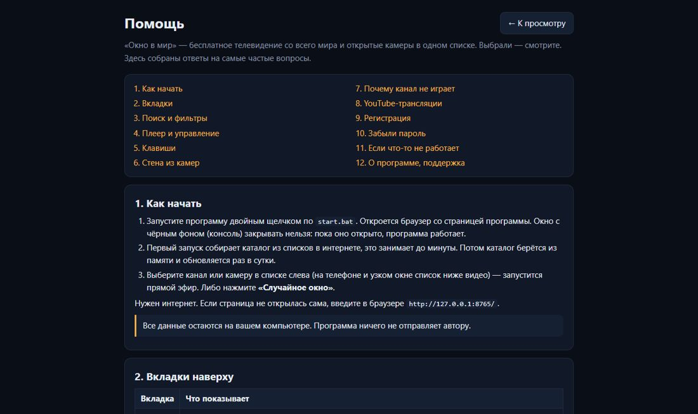

  <a href="https://dalink.to/olegche"><b>❤ Помощь проекту</b></a> ·
  <a href="https://t.me/PravDoruB"><b>✈ Контакты (Telegram)</b></a>

# Окно в мир

Бесплатное ТВ со всего мира и открытые камеры в одном списке: включил и смотришь. Программа для Windows, работает в браузере, ставить ничего не нужно, кроме Python.

## Возможности

- **ТВ со всего мира.** Около 24 тысяч позиций в каталоге (ТВ-каналы, камеры), из них рабочих порядка 17 тысяч. Страны, темы, поиск по названию.
- **Камеры.** Видовые (природа, города, порты, пляжи, горы) и дорожные. Снимки и видео, в том числе YouTube-трансляции (выключены по умолчанию, включаются галочкой).
- **Стена.** Девять камер одновременно на одном экране.
- **Подборка «Познавательное».** Discovery, National Geographic, Animal Planet, History, TLC, Viasat и другие, в том числе на русском.
- **Запасные ссылки.** У канала несколько вариантов: если основной не отвечает, плеер сам берёт следующий. Мёртвые ссылки программа отмечает проверкой в фоне и скрывает.
- **Быстрый старт.** Следующий канал и канал под курсором подгружаются заранее, поэтому переключение занимает доли секунды.
- **Плеер.** Пауза, громкость, полный экран, «Случайное окно», автопереход, если поток молчит, управление с клавиатуры.
- **18+ только после регистрации.** Вкладка и каналы для взрослых скрыты, пока вы не создали локальный аккаунт и не подтвердили возраст. Данные хранятся только на вашем компьютере, пароль в виде хеша; есть код восстановления. Без входа сервер не отдаёт ни названия, ни ссылки таких каналов.
- **Справка** прямо в программе (кнопка «Справка» в шапке).

| Стена из 9 камер | Справка |
|---|---|
|  |  |

## Запуск

Нужны Windows 10/11 и [Python 3.12](https://www.python.org/downloads/) (при установке отметьте «Add python.exe to PATH»). Других зависимостей нет: только стандартная библиотека.

1. Скачайте архив из [Releases](../../releases/latest) и распакуйте, либо клонируйте репозиторий.
2. Дважды щёлкните **`start.bat`**. Появится заставка «Загрузка…», затем откроется браузер. Консоль не нужна.
3. Первый запуск собирает каталог из интернета, это занимает пару минут. Дальше каталог берётся из кэша и обновляется раз в сутки.

На рабочем столе появится ярлык «Окно в мир»; в области уведомлений — значок с пунктами «Открыть в браузере» и «Выход». Адрес программы: <http://127.0.0.1:8765/>.

Из консоли: `python server.py` (порт можно задать переменной `PORT`).

Забыли пароль от 18+ и нет кода восстановления: запустите `reset18.bat`, он удалит локальный аккаунт.

## Как это устроено

- `server.py`: локальный сервер (Python, только stdlib) по адресу 127.0.0.1. Отдаёт каталог, проверяет ссылки в фоне, проксирует потоки (пересобирает плейлисты, подставляет нужные заголовки, держит соединения, «подогревает» каналы).
- `sources.py`: ТВ-списки и слияние одинаковых каналов в один с запасными вариантами. `viewcams.py`: видовые камеры.
- `index.html`: плеер и интерфейс; `help.html`: справка.
- `launcher.py`, `tray.py`: запуск без консоли, заставка и значок в трее.
- `tools/`: сборка значка (`python tools/build.py`).

Свои списки и камеры можно добавить файлом `extra_sources.json` в корне: `{"m3u": [{"name": "…", "url": "…", "country": "RU"}], "cams": [{"n": "…", "u": "…", "x": "jpeg|hls|mp4|mjpeg", "c": "RU", "g": "city", "lat": 0, "lon": 0}]}`; ключи Windy Webcams и OpenWebcamDB — переменными окружения `WINDY_API_KEY`, `OPENWEBCAMDB_API_KEY` или файлом `keys.json`.

## Источники

Программа ничего не хранит и не ретранслирует сама: она собирает ссылки из открытых списков и показывает потоки с их собственных серверов.

- ТВ: [iptv-org/iptv](https://github.com/iptv-org/iptv) (страны, языки, категории, база потоков), [Free-TV/IPTV](https://github.com/Free-TV/IPTV), русскоязычные списки на GitHub (Dimonovich, Karnei4, LoganetX, ngrch, troypaha, tv-rus), открытые списки для взрослых (adultiptv.net, THEMMMINAT/xxx-IPTV, Izanami1618/AdultChannels).
- Камеры: [Live-Environment-Streams](https://github.com/stuchapin909/Live-Environment-Streams) (дорожные), EarthCam, Open-Eagle-Eye, [lukarne](https://github.com/storagebits/lukarne) (YouTube 24/7), по ключу — Windy Webcams и OpenWebcamDB.
- Плееры в браузере: [hls.js](https://github.com/video-dev/hls.js), [mpegts.js](https://github.com/xqq/mpegts.js).

Каналы и камеры принадлежат их владельцам. Часть ссылок со временем перестаёт работать: это нормально для бесплатных списков, программа такие скрывает. Каналы 18+ предназначены только для совершеннолетних.

## Помощь проекту

Если программа пригодилась, поддержать автора можно здесь: **<https://dalink.to/olegche>**

## Контакты

Telegram-канал автора: **<https://t.me/PravDoruB>**
